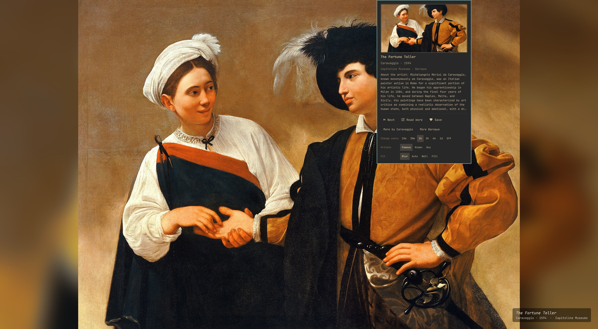
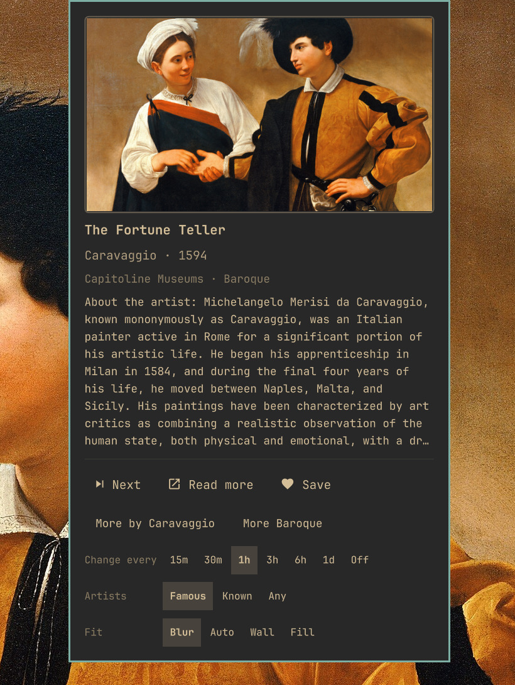
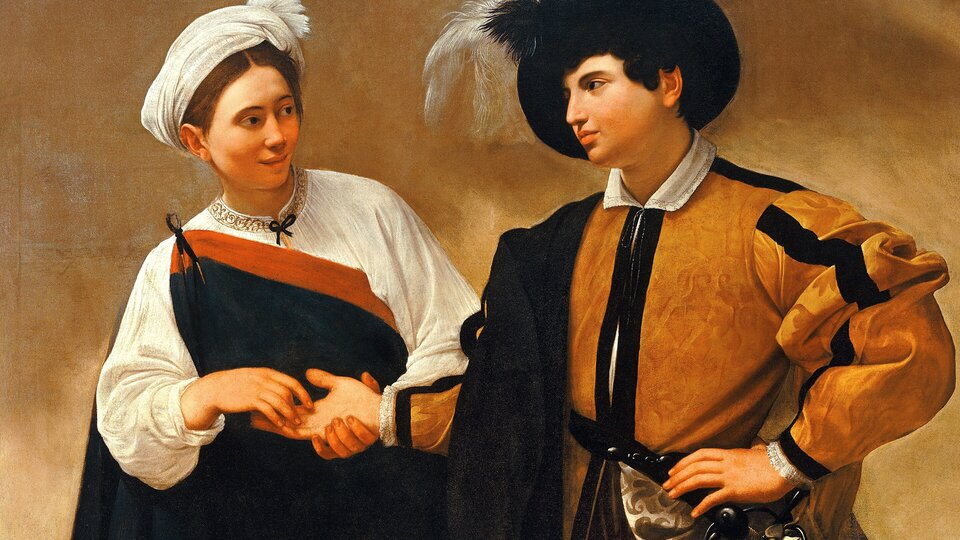
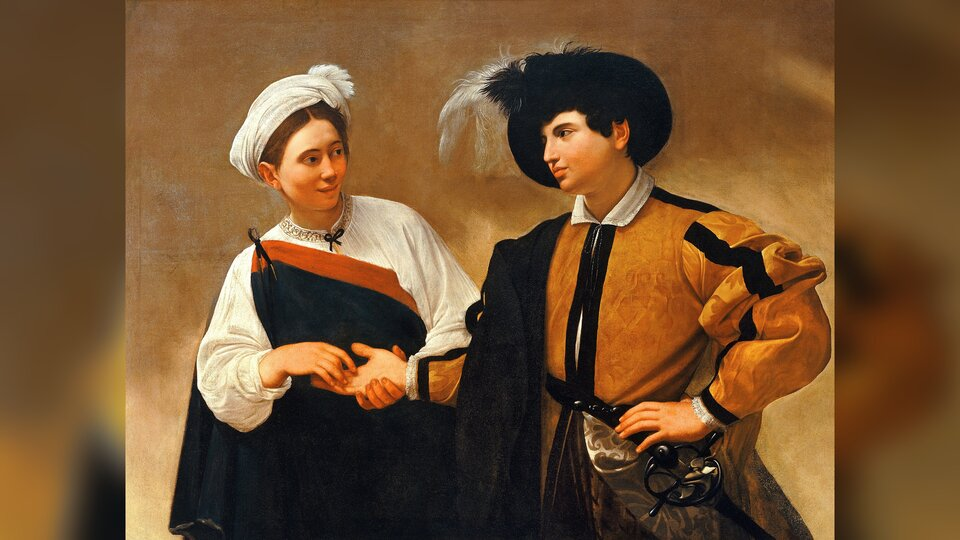
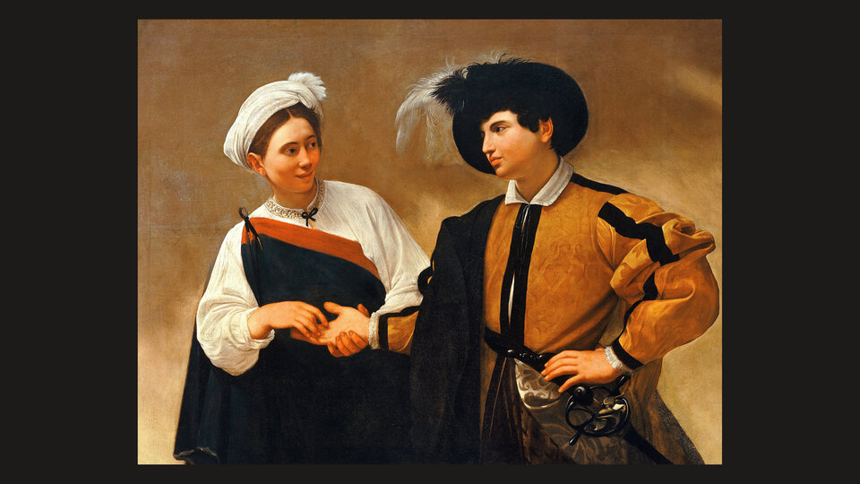
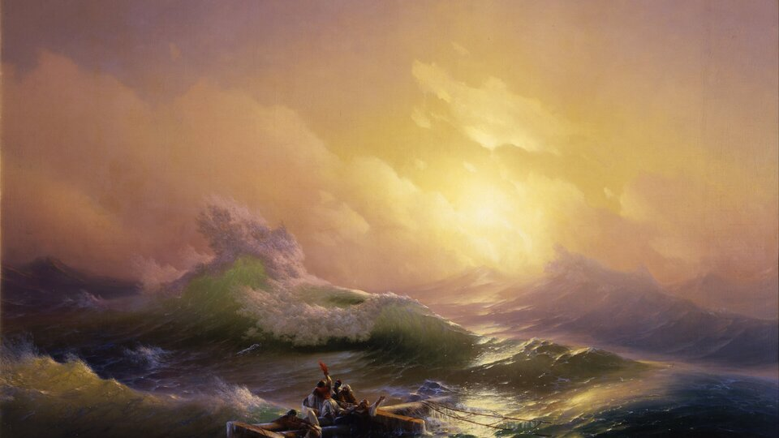
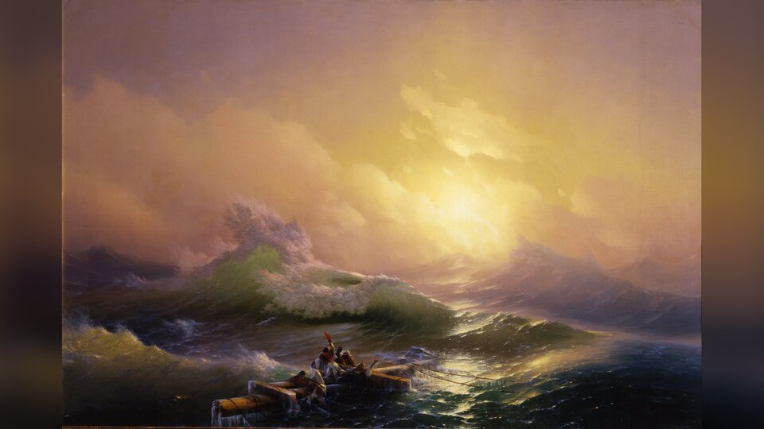
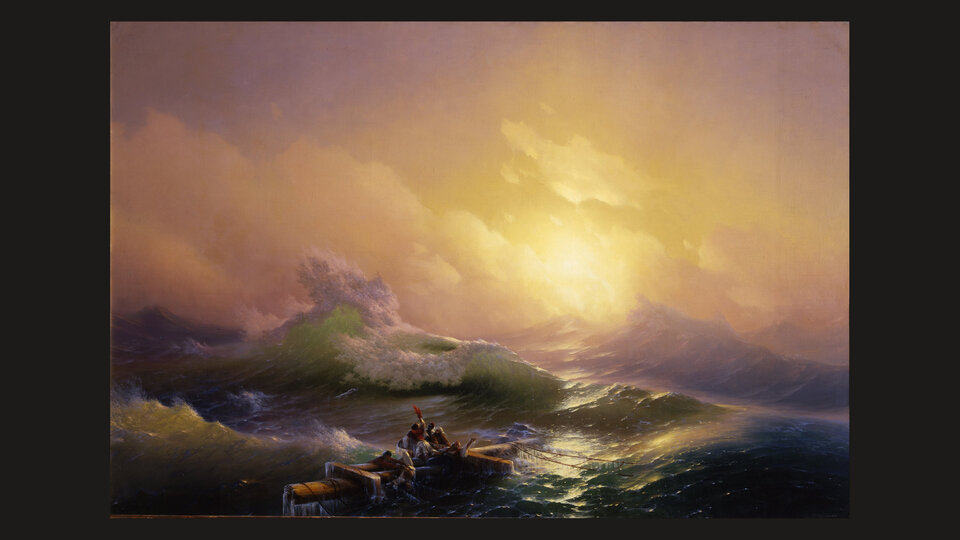

# Museum Wallpapers

An [Omarchy](https://omarchy.org) shell plugin that turns your desktop into a
slow museum walk: an endless supply of public-domain paintings from museums
worldwide, a new one every hour (or whenever you like), with the title,
artist, year, museum and a short story one click away.

- **Endless and high-resolution.** Tens of thousands of paintings listed on
  Wikidata, shown from their Wikimedia Commons scans, many of them
  [Google Art Project](https://commons.wikimedia.org/wiki/Category:Google_Art_Project)
  museum photography: only scans large enough for your screen (up to 4K),
  only landscape-shaped works, never tiles or detail crops.
- **Know what you are looking at.** Title, artist, year, museum and movement
  from Wikidata, plus the opening of the painting's Wikipedia article (or the
  artist's, when the painting has none).
- **Famous painters first.** By default only the ~280 painters covered by 60+
  Wikipedias (Leonardo, Rembrandt, Van Gogh, Monet, Aivazovsky…); widen it to
  ~1200 or to everyone.
- **Filters.** Narrow it further by years, artists, movements and genres, set
  in the config or with one click from the popup ("More by Claude Monet",
  "More Impressionism").
- **Show as much or as little as you want.** Every way of showing the painting
  is optional and independent; turn them all off for wallpapers only.




<p align="center">
  
</p>

## Ways to see the painting

| Mode | What it does | How to turn it on |
| --- | --- | --- |
| Bar widget | Palette icon; hover for "Title — Artist", click for a card with a preview, the summary, **Next**, **Read more**, **Save**, quick filters, and the change interval, artist fame and fit settings; middle-click for the next painting | Add `io.github.dpsk.museum-wallpapers` to the bar (see Install) |
| Desktop placard | A small museum-style label (title, artist, year, museum) in a corner of the desktop, under your windows, click-through | On by default (bottom right); `"placard": "off"` hides it, or pick another corner |
| Notification on change | Title, artist, museum and summary each time the painting changes, with a **Read more** action | Off by default; `"notifyOnChange": true` |
| Hotkeys / IPC | Open the card (or a notification when the widget is not on the bar), skip, save, open the article | Bind `omarchy-shell museum-wallpapers …` (see below) |

## Install

```bash
omarchy plugin add https://github.com/dpsk/omarchy-museum-wallpapers --enable
```

`--enable` starts the service and adds the widget to the right side of the bar.
To use it without the widget, remove the widget from the bar; the service keeps
rotating paintings. Requires `python3` (standard library only), ImageMagick for
framing (both ship with Omarchy) and network access to Wikimedia.

The first painting appears within seconds: the painter lists ship with the
plugin. A theme switch sets the theme's own
background; the plugin takes over again at the next interval.

## Remove

The current background is a file in the plugin's cache, so pick another one
first, then remove the plugin and its files:

```bash
omarchy theme bg next   # or: omarchy theme bg set <image>
omarchy plugin remove io.github.dpsk.museum-wallpapers
rm -rf ~/.cache/museum-wallpapers ~/.local/state/museum-wallpapers
```

Remove any hotkeys you added to `~/.config/hypr/bindings.lua`. Paintings you
saved stay in your `saveDir`.

## Settings

Settings go in the plugin's entry in `~/.config/omarchy/shell.json`: either the
bar widget entry (which Omarchy's widget settings editor writes) or an entry in
`plugins`. When both exist, the bar widget entry wins.

```json
{
  "bar": {
    "layout": {
      "right": [
        {
          "id": "io.github.dpsk.museum-wallpapers",
          "intervalMinutes": 60,
          "placard": "bottom-right",
          "notifyOnChange": false,
          "language": "auto",
          "saveDir": "~/Pictures/Wallpapers/Museum",
          "filters": { "movements": ["Impressionism"], "genres": ["landscape"] }
        }
      ]
    }
  }
}
```

| Key | Default | Meaning |
| --- | --- | --- |
| `intervalMinutes` | `60` | Minutes between paintings; `0` changes only on demand. Also settable from the popup. |
| `placard` | `"bottom-right"` | `off`, `bottom-right`, `bottom-left`, `top-right` or `top-left`. |
| `notifyOnChange` | `false` | Notify each time the painting changes. |
| `language` | `"auto"` | `auto` follows the system language (`LANG`). Wikipedia language for titles and summaries (`de`, `fr`, `ru`, …), falling back to English. The interface (popup, notifications, messages) speaks English, Русский, Українська, Deutsch, Français, Español, Italiano, Nederlands, Polski and Português; other languages get an English interface. Also settable from the popup. |
| `saveDir` | `~/Pictures/Wallpapers/Museum` | Where **Save** copies paintings (with a `CREDITS.md` line). Also the offline fallback: without network, a painting from here or from the download cache is shown. |
| `filters` | none | See below. |
| `prefetchCount` | `6` | Paintings downloaded ahead, so several **Next** presses in a row are instant. |
| `cacheSize` | `24` | Downloaded paintings kept in `~/.cache/museum-wallpapers`. |
| `fame` | `"famous"` | `famous`, `known` or `any`; see [How famous the painters are](#how-famous-the-painters-are). Also settable from the popup. |
| `fit` | `"blur"` | `blur`, `auto`, `wall` or `cover`; see [Paintings that are not 16:9](#paintings-that-are-not-169). Also settable from the popup ("Fill" is `cover`). |
| `minRatio`, `maxRatio` | `1.3`, `2.0` | Accepted width/height ratios. |

### How famous the painters are

`fame` picks whose paintings appear. Fame is measured the way Wikidata can:
by how many Wikipedia language editions have an article on the painter
(Leonardo ~300, Rembrandt ~200, Aivazovsky ~100).

| `fame` | Painters | Paintings to choose from |
| --- | --- | --- |
| `"famous"` (default) | ~280, in 60+ Wikipedias | ~38,000 on Wikidata |
| `"known"` | ~1200, in 30+ Wikipedias | ~94,000 on Wikidata |
| `"any"` | everyone | the ~12,000 Google Art Project scans, plus any filter's matches |

Only scans large enough for your screen are shown, so the usable share is
smaller. An artist you filter by (or pick with **More by …**) is shown however
famous they are. The painter lists for `"famous"` and `"known"` ship with the
plugin, so the first painting does not wait for Wikidata; a detached helper
refreshes them in the background once a week (other filters' pools are fetched
from Wikidata when first used, which takes up to half a minute, and cached).
The count also
rewards fame outside painting, so a few famous people who painted as a side
pursuit are included.

### Paintings that are not 16:9

Few paintings have your screen's shape. `fit` decides what happens to the rest:

| `"fit": "cover"` | `"fit": "blur"` (default) | `"fit": "wall"` |
| --- | --- | --- |
|  |  |  |
|  |  |  |
| Fills the screen and crops the edges | The whole painting, framed by a blurred copy of itself | The whole painting, with a margin, on a dark wall |

`"fit": "auto"` fills the screen when that crops 10% of the painting or less,
and frames it like `blur` otherwise. Framing uses ImageMagick, which Omarchy
ships; without it, paintings are shown as with `cover`. Changing `fit` applies
to the painting on screen within a minute; **Save** always keeps the original
painting, unframed.

### Filters

```json
"filters": {
  "yearFrom": 1850,
  "yearTo": 1900,
  "artists": ["Claude Monet", "Ivan Aivazovsky"],
  "movements": ["Impressionism", "Romanticism"],
  "genres": ["landscape", "marine"]
}
```

A year range is part of the Wikidata query, except with `"fame": "any"` and no
other filter: then it narrows the random Google Art Project pool (Wikidata
cannot list every painting of a period fast enough). Narrow year-only ranges may
find nothing, which falls back to random paintings with one notification.

Values within one list are alternatives (Monet *or* Aivazovsky); different
lists must all match. Names are looked up on Wikidata; a Wikidata id such as
`"Q296"` works too. Built-in genre names: `landscape`, `portrait`, `still life`,
`marine`/`seascape`, `genre`, `history`, `religious`, `cityscape`.

A movement matches paintings tagged with it and paintings by artists tagged
with it, since Wikidata tags movements on artists far more often.

The popup's **More by …** and **More …** buttons set a temporary filter that
replaces the configured one until you clear it with ×. The same from a terminal:

```bash
python3 ~/.config/omarchy/plugins/io.github.dpsk.museum-wallpapers/museum.py filter set --years 1850-1900 --switch
python3 ~/.config/omarchy/plugins/io.github.dpsk.museum-wallpapers/museum.py filter clear --switch
```

When a filter matches nothing large enough for your screen, you get a
notification and random paintings until the filter changes. When a small
filter has shown everything it matches, paintings repeat.

## Hotkeys and IPC

```lua
-- ~/.config/hypr/bindings.lua
o.bind("SUPER + CTRL + ALT + P", "Painting info", "omarchy-shell museum-wallpapers info")
o.bind("SUPER + CTRL + ALT + N", "Next painting", "omarchy-shell museum-wallpapers next")
```

| Call | Effect |
| --- | --- |
| `omarchy-shell museum-wallpapers info` | Toggle the card on the bar, or show a notification without the widget |
| `omarchy-shell museum-wallpapers next` | Next painting (prefetched, so usually instant); presses while one is still switching are ignored |
| `omarchy-shell museum-wallpapers notify` | Notification about the current painting |
| `omarchy-shell museum-wallpapers open` | Open its Wikipedia article (or Commons page) |
| `omarchy-shell museum-wallpapers keep` | Save it to `saveDir` |
| `omarchy-shell museum-wallpapers clearFilter` | Drop the popup's temporary filter |
| `omarchy-shell museum-wallpapers status` | Current state as JSON |

## Data, privacy and licensing

The plugin talks only to Wikimedia: `commons.wikimedia.org` (search, image
info, downloads from `upload.wikimedia.org`), `www.wikidata.org` and
`query.wikidata.org` (painting data, filters), and `*.wikipedia.org` (summaries).
Requests carry a User-Agent naming this plugin and nothing about you.

The images are photographs of public-domain paintings. Summaries are excerpts
from Wikipedia (CC BY-SA); **Read more** links to the source article.

State lives in `~/.local/state/museum-wallpapers` (current painting, popup
filter, name lookups) and images in `~/.cache/museum-wallpapers`.

## Troubleshooting

- **Nothing changes:** `omarchy-shell museum-wallpapers status` shows the last
  error; `journalctl --user | grep museum-wallpapers` shows helper output.
- **The placard is not visible:** it sits under windows, so it shows on an
  empty workspace; it hides when the background is not from this plugin.
- **Next feels slow:** `journalctl --user | grep "museum-wallpapers: timing"`
  shows how long each stage (search, download, framing, setting the
  background) took, and which thread did it.
- **Replacement bars:** the widget needs Omarchy's built-in bar; bars from
  other plugins do not give widgets access to plugin services.
- **After editing the plugin's QML:** run `omarchy restart shell` (the service
  stays loaded across hot reloads).

## Development

```bash
make check   # unit tests, py_compile, qmllint, omarchy-plugin-validate
make dev     # copy the working tree over the installed plugin
make seed    # refresh the built-in painter lists in seed/ from Wikidata (by hand, before a release)
```

## License

MIT
